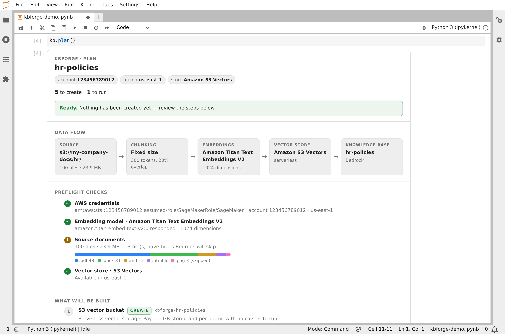
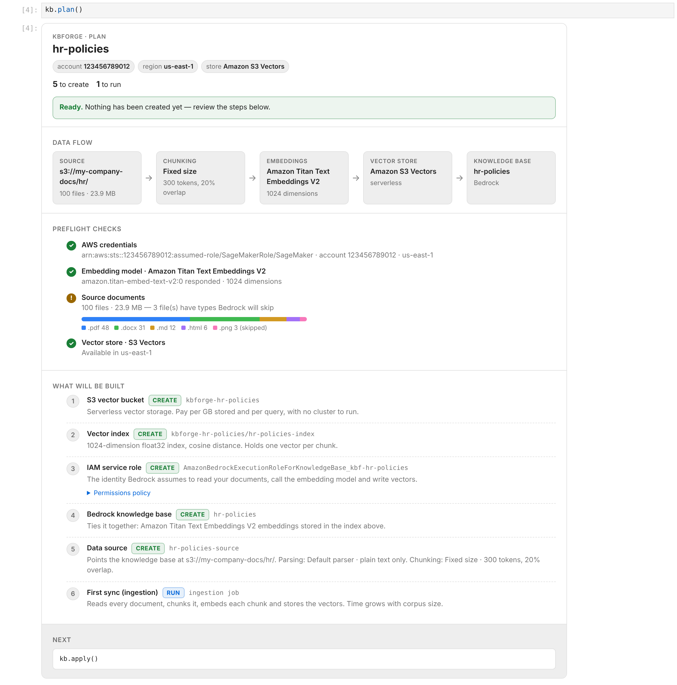
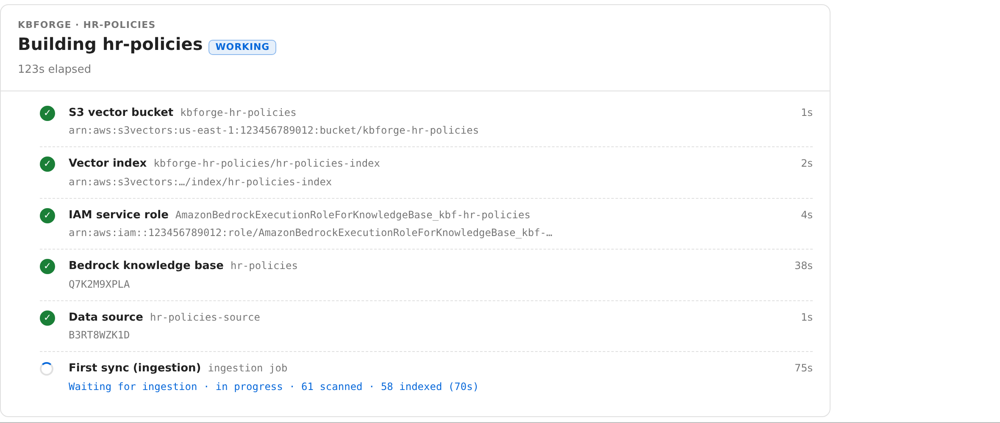
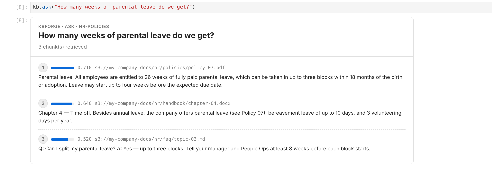
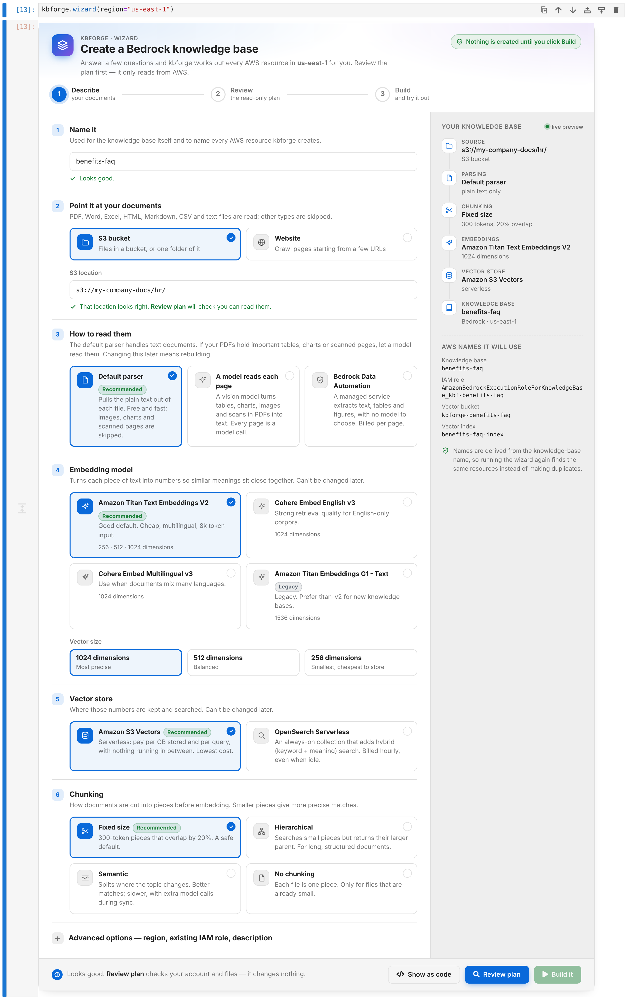
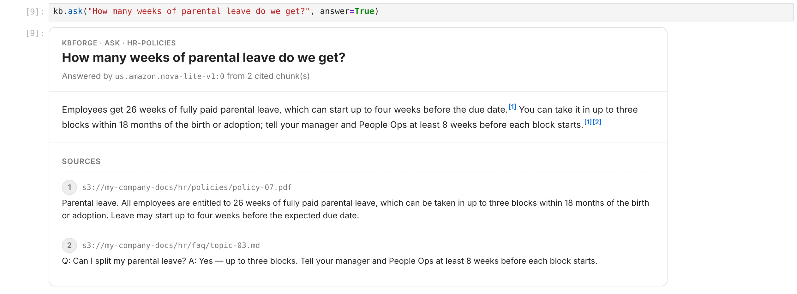
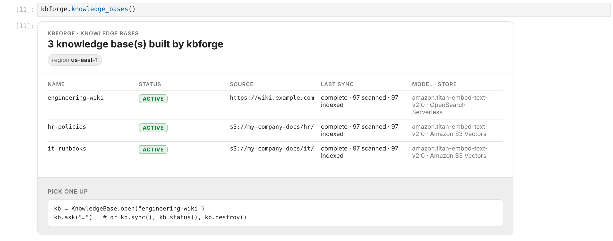
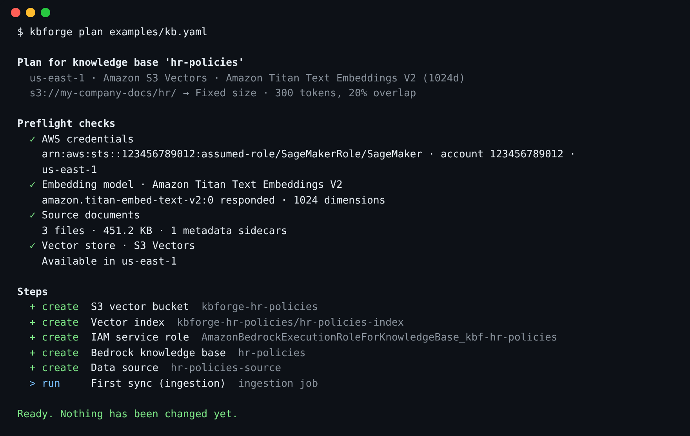
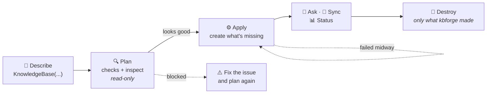

<div align="center">

# 🧱 kbforge

**From documents in S3 to an Amazon Bedrock Knowledge Base in four notebook cells,<br>with a plan you can read before anything is created.**

[](https://github.com/utkarsh5026/bedrcok/actions/workflows/ci.yml)
[](pyproject.toml)
[](https://aws.amazon.com/bedrock/knowledge-bases/)
[](notebooks/getting_started.ipynb)
[](LICENSE)
[](https://utkarsh5026.github.io/bedrcok/)

[**Guide**](https://utkarsh5026.github.io/bedrcok/) ·
[**Quick start**](#quick-start) ·
[**How it works**](#how-it-works) ·
[**Options**](#options) ·
[**Development**](#development)

<br>

<picture><source media="(prefers-color-scheme: dark)" srcset="docs/assets/screens/jupyterlab-dark.png"></picture>

</div>

<br>

## 🤔 Why

Creating a Bedrock knowledge base by hand means an S3 Vectors bucket (or an OpenSearch collection with three policies), a vector index, an IAM role with the right trust and permissions, the knowledge base, a data source and an ingestion job. Usually that's a notebook of cells you run in order and hope.

kbforge turns that into **describe → plan → apply → ask**:

```python
%pip install -q "kbforge[notebook] @ git+https://github.com/utkarsh5026/bedrcok.git"

from kbforge import KnowledgeBase

kb = KnowledgeBase("hr-policies", source="s3://my-company-docs/hr/")
kb.plan()     # read-only: checks your access, model and files; lists what will be built
kb.apply()    # builds it with live progress (safe to re-run if anything fails)
kb.ask("How many weeks of parental leave do we get?")
```

<table>
<tr>
<td width="50%" valign="top">

### 🔍 The plan comes first

Each AWS resource is shown with its name, its purpose, and whether it will be **created**, **reused** or **updated**. Nothing is touched until you call `apply()`.

</td>
<td width="50%" valign="top">

### 🚦 Problems surface up front

No model access, a missing or empty bucket, files Bedrock will skip, or a region mismatch all appear *before* anything is built.

</td>
</tr>
<tr>
<td width="50%" valign="top">

### 🔁 Re-runs are safe

Resource names are derived from the KB name, so a second run finds what already exists and picks up where it left off. There's no state file.

</td>
<td width="50%" valign="top">

### 🧹 Teardown is safe

`kb.destroy()` only *shows* what would be deleted; `destroy(confirm=True)` deletes it. Your documents, your own role, and anything kbforge didn't create are left alone.

</td>
</tr>
</table>

## 📸 See it in action

<table>
<tr>
<td align="center" width="50%"><b>1 · Plan</b>: read-only, nothing created yet</td>
<td align="center" width="50%"><b>2 · Apply</b>: live progress, step by step</td>
</tr>
<tr>
<td><picture><source media="(prefers-color-scheme: dark)" srcset="docs/assets/screens/plan-dark.png"></picture></td>
<td><picture><source media="(prefers-color-scheme: dark)" srcset="docs/assets/screens/progress-dark.png"></picture></td>
</tr>
<tr>
<td align="center"><b>3 · Ask</b>: retrieved chunks with scores and sources</td>
<td align="center"><b>Prefer a form?</b> <code>kbforge.wizard()</code></td>
</tr>
<tr>
<td><picture><source media="(prefers-color-scheme: dark)" srcset="docs/assets/screens/ask-dark.png"></picture></td>
<td><picture><source media="(prefers-color-scheme: dark)" srcset="docs/assets/screens/wizard-form-dark.png"></picture></td>
</tr>
<tr>
<td align="center"><b>Want an answer?</b> <code>kb.ask(…, answer=True)</code></td>
<td align="center"><b>Built one before?</b> <code>kbforge.knowledge_bases()</code></td>
</tr>
<tr>
<td><picture><source media="(prefers-color-scheme: dark)" srcset="docs/assets/screens/answer-dark.png"></picture></td>
<td><picture><source media="(prefers-color-scheme: dark)" srcset="docs/assets/screens/list-dark.png"></picture></td>
</tr>
</table>

<details>
<summary><b>🖥️ Prefer a terminal or CI?</b> The same plan works from the <code>kbforge</code> command.</summary>
<br>

```bash
kbforge plan  examples/kb.yaml     # or examples/kb.json: same keys, either format
kbforge apply examples/kb.yaml
```

[`examples/kb.yaml`](examples/kb.yaml) documents every option, including the settings for each chunking strategy. [`examples/README.md`](examples/README.md) has the JSON versions.



</details>

<a id="quick-start"></a>

## 🚀 Quick start

1. **Get the notebook** and run it top to bottom. Pick whichever is easiest:

   - **Download it:** right-click [**getting_started.ipynb**](https://raw.githubusercontent.com/utkarsh5026/bedrcok/main/notebooks/getting_started.ipynb) and choose *Save link as…*, then drag the file into SageMaker's file browser. (Or open [the notebook on GitHub](notebooks/getting_started.ipynb) and use the *Download raw file* button.)
   - **Fetch it straight into SageMaker:** open a terminal there (*File → New → Terminal*) and run:

     ```bash
     curl -LO https://raw.githubusercontent.com/utkarsh5026/bedrcok/main/notebooks/getting_started.ipynb
     ```

2. **Check permissions.** Your notebook role needs the permissions in [`docs/notebook-role-policy.json`](docs/notebook-role-policy.json).
   > [!TIP]
   > If IAM is locked down in your account, pass an existing Bedrock role as `role_arn=` and kbforge won't try to create one.
3. **Read the guide.** The [guide](https://utkarsh5026.github.io/bedrcok/) has a short video tour; the [reference](https://utkarsh5026.github.io/bedrcok/reference.html) covers every option, how to choose settings, and troubleshooting.

Once it's built, the rest of the lifecycle is one call each:

| Call | What it does |
| --- | --- |
| `kb.sync()` | Re-ingests the source after documents are added, changed or removed |
| `kb.status()` | Shows ids, health, and how the last sync went |
| `kb.ask("…")` | Retrieves the best-matching chunks for a question |
| `kb.ask("…", answer=True)` | Also has a model (Nova Lite by default; pick another with `model=`) write an answer that cites those chunks |
| `kbforge.knowledge_bases()` | Lists the knowledge bases kbforge built in the region, with health and last sync |
| `KnowledgeBase.open("name")` | Picks up a deployed knowledge base in a fresh notebook, without retyping its settings |
| `kb.destroy()` | Shows what would be deleted; add `confirm=True` to delete it |

<a id="how-it-works"></a>

## 🧭 How it works



Every AWS resource is a step that is first **inspected** (never changed) and then, during apply, **re-inspected just before acting**. That's why a failed run can simply be run again: finished steps are skipped.

<a id="options"></a>

## ⚙️ Options at a glance

| Option | Default | Choices |
| --- | --- | --- |
| `source` | *required* | `s3://bucket/prefix/`, `https://site`, `S3Source`, `WebSource` |
| `embedding` | `titan-v2` | `titan-v2`, `cohere-en`, `cohere-multi`, `titan-v1` |
| `vector_store` | `s3_vectors` | `s3_vectors`, `opensearch_serverless` (needs `kbforge[opensearch]`) |
| `chunking` | `fixed` (300 tokens, 20%) | `fixed`, `hierarchical`, `semantic`, `none`, or `Chunking.fixed(500, 10)` |
| `parsing` | `default` (plain text) | `default`, `data_automation`, or a parsing model such as `nova-lite`; `kbforge.parsing_models()` lists the ones your account can use |
| `role_arn` | create one | an existing role that trusts `bedrock.amazonaws.com` |
| `region`, `tags`, `description`, `permissions_boundary`, `sync` | | see the [guide](https://utkarsh5026.github.io/bedrcok/) |

The same keys work in a YAML or JSON file: `KnowledgeBase.from_file("kb.json")` loads one, and `kb.save("kb.json")` writes one. See [`examples/`](examples/).

<a id="development"></a>

## 🛠️ Development

```bash
uv sync --all-extras          # package + dev tools
uv run pytest                 # tests run against an in-memory fake AWS, no account needed
uv run ruff check src tests scripts && uv run ruff format --check src tests scripts && uv run mypy

# regenerate the screenshots in docs/ (runs a real JupyterLab with Playwright)
uv run --group docs python scripts/docs_screenshots.py
```

**CI/CD** lives in [`.github/workflows`](.github/workflows):

| Workflow | Runs on | What it does |
|---|---|---|
| [CI](.github/workflows/ci.yml) | every PR and push to `main` | ruff, mypy, tests on Python 3.10–3.14 (plus the oldest allowed dependency versions), and builds the wheel and runs `kbforge --help` from it |
| [Pages](.github/workflows/pages.yml) | pushes to `main` that change `docs/` | deploys the [guide](https://utkarsh5026.github.io/bedrcok/) |
| [Release](.github/workflows/release.yml) | pushing a `v*` tag | reruns CI, checks the tag matches `pyproject.toml`, and publishes a GitHub Release with the wheel and sdist attached |

[Dependabot](.github/dependabot.yml) opens weekly grouped PRs for `uv.lock` and the GitHub Actions.

To cut a release:

```bash
uv version --bump minor                 # or patch / major
git commit -am "Release v$(uv version --short)" && git push
git tag "v$(uv version --short)" && git push origin "v$(uv version --short)"
```

Then install a pinned version with `pip install "kbforge[notebook] @ git+https://github.com/utkarsh5026/bedrcok.git@v0.2.0"`.

See [CLAUDE.md](CLAUDE.md) for how the code is organised.

## 📄 License

[Apache-2.0](LICENSE)
